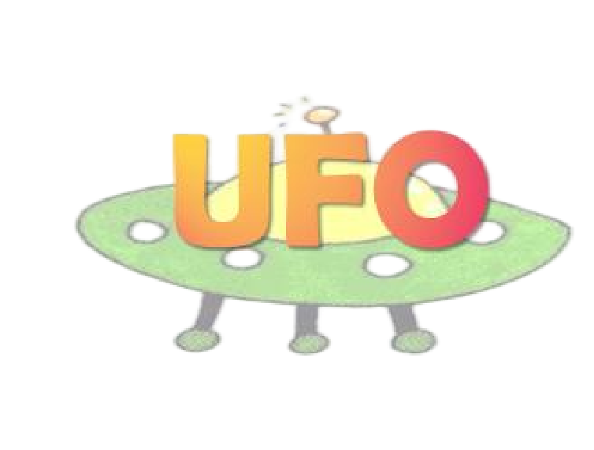
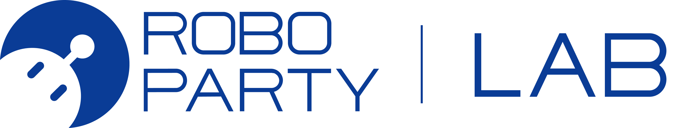

<h1 align="center">
  UFO: A General <b>U</b>nsupervised Reinforcement Learning <b>F</b>ramework for Humanoid C<b>O</b>ntrol
</h1>

<p align="center">
  <a href="https://roboparty.github.io/UFO/"></a>
  <a href="https://youtu.be/uJPcLdn9sNA"></a>
  <a href="https://roboparty.github.io/UFO/assets/UFO.pdf"></a>
</p>

<p align="center">
  <a href="README.md">English</a> | <a href="README_zh-CN.md">中文</a>
</p>

<p align="center">
  
  &nbsp;&nbsp;&nbsp;&nbsp;&nbsp;&nbsp;
  
</p>

UFO is an unsupervised reinforcement learning framework for humanoid control, built on **mjlab**. It supports **Unitree G1 / RoboParty RP1.3 / RPO**, multi-GPU training, and tracking, reward and goal inference. G1 and RP1 support **FB-CPR-Aux / TeCH**; the released RPO baseline uses FB-CPR-Aux.

**The RP1 TeCH policy has not been tested on the physical robot.**

**[G1 / RP1 / RPO training data](https://huggingface.co/datasets/xuewang/UFO-MotionData), the [G1 FB policy tested on hardware](https://huggingface.co/xuewang/ufo-g1-policy), and the [RPO FB policy](https://huggingface.co/xuewang/ufo-rpo-policy) are available.**

## News

**2026-10-15 — Training performance and multi-robot update**

**192M-step FB / mjlab training:** all runs below use **8 × NVIDIA H20**, **BF16 mixed precision**, and **1024-wide networks with shared critics**.

| Experiment | Global training FPS | Last EMD ↓ | Time to 192M steps |
| --- | ---: | ---: | ---: |
| G1: original DR + original reward | **12,440** | **0.6655** | **4 h 45 min** |
| G1: extended DR + original reward | **12,467** | **0.7406** | **≈4 h 51 min** |
| G1: extended DR + updated reward | **12,217** | **0.7554** | **4 h 55 min** |
| RP1: baseline | **12,485** | **0.7139** | **4 h 48 min** |

<details>
<summary>Measurement settings and scope</summary>

All runs use 1,024 environments and batch size 1,024 per GPU, six residual layers, and 16 agent updates per rollout step. FPS counts environment transitions across all eight GPUs and is the median of the last 20 logged intervals, not whole-job throughput.

All three G1 runs use LaFAN-40 and 30% lying-down initialization. The original-DR run predates the reset-boundary fix; the extended-DR/original-reward run includes it. These historical runs span code changes and are not a controlled DR/reward ablation. The updated reward replaces the undesired-contact penalty with a body-impact penalty, sets the slip penalty weight to -4, and adds a foot-stumble penalty with weight -2. RP1 uses common LaFAN-40 and no lying-down initialization. BF16 is an experiment override for G1; the current G1 FB default remains FP32 + TF32, while RP1 FB defaults to BF16.

EMD is the mean over the last periodic tracking evaluation: all three G1 runs at 188,981,248 steps (862 clips), RP1 at 190,054,400 steps (902 clips), rather than a new evaluation of the final checkpoint. Wall time includes startup, evaluation and checkpoint saving. Times use launcher start/end records, except for G1 extended DR + original reward: its time is estimated from launch to the completed final save because its launcher completion timestamp is unavailable. All runs completed 191,995,904 steps under the nominal 192M budget.

</details>

The release also replaces the legacy `humanoidverse` layout with `ufo`, unifies G1 / RP1 and FB / TeCH commands, fixes reset-boundary observations and contact-force direction, and provides robot-aware ONNX exports, RP1 data and a G1 policy tested on hardware. See [architecture](docs/ARCHITECTURE.md) and [training/inference](docs/TRAIN_INFERENCE.md).

## Install

Requires Linux and an NVIDIA driver compatible with CUDA 12.8. The lockfile selects PyTorch 2.7.1 / CUDA 12.8 and NCCL 2.26.5, including Blackwell support. Run these commands, then work from the repository root:

```bash
git clone https://github.com/Roboparty/UFO.git
cd UFO
python3 -m pip install --user uv
export PATH="$HOME/.local/bin:$PATH"
uv sync --locked
```

This guide requires the mjlab checkout containing `ufo/` and `run_inference.sh`; it does not apply to the older `humanoidverse/` release. Video export requires `ffmpeg` (`sudo apt install ffmpeg` on Ubuntu).

## Prepare data

Download matching full motions and training clips; the script verifies SHA256:

```bash
bash scripts/download_data.sh g1_lafan
bash scripts/download_data.sh rp1_lafan
bash scripts/download_data.sh rpo_lafan
```

G1 contains 40 motions. RP1 contains 55 motions and 1,166 training clips; RPO contains 56 motions and 1,168 training clips. RP1 and RPO data are 50 Hz and use their robot-specific joint layouts. Motion data cannot be shared directly between robots.

For local files, including RPO data, see [data paths](docs/ROBOT_ADAPTATION.md#use-converted-data). To convert your own source files, see the [RP1](docs/ROBOT_ADAPTATION.md#rp1-data-import) and [RPO](docs/ROBOT_ADAPTATION.md#rpo-data-import) import instructions.

## Train

After preparing data, choose one command:

```bash
./run_train.sh --robot g1  --agent fb   --gpu-ids all
./run_train.sh --robot rp1 --agent fb   --gpu-ids all
./run_train.sh --robot rpo --agent fb   --gpu-ids all
./run_train.sh --robot g1  --agent tech --gpu-ids all
./run_train.sh --robot rp1 --agent tech --gpu-ids all
```

RPO TeCH has not been validated and is not part of the released RPO baseline.

`--gpu-ids all` uses all visible GPUs; use `CUDA_VISIBLE_DEVICES` to select them. `--gpu-ids single --smoke` checks startup and sampling only; it does not update weights. See [a short training check with updates](docs/TRAIN_INFERENCE.md#short-training-check).

Runs default to `runs/<robot>_<agent>`. Use a new `--work-dir` for each experiment; an existing checkpoint in that directory is resumed. To enable W&B:

```bash
uv run wandb login
WANDB_PROJECT=UFO ./run_train.sh --robot g1 --agent fb --gpu-ids all \
  --work-dir runs/g1_fb_exp --use-wandb --wandb-run-name g1_fb_exp
```

## Inference

Inference reads robot settings from the saved run. Use a checkpoint trained for the selected robot and matching motion data:

```bash
./run_inference.sh tracking --model-folder runs/g1_fb --motion-list 0 --save-mp4
./run_inference.sh reward --model-folder runs/g1_fb --save-mp4
./run_inference.sh goal --model-folder runs/g1_fb \
  --data-path ufo/data/lafan_29dof.pkl --save-mp4
```

- **Tracking:** FB and TeCH for G1/RP1, and FB for RPO. Add `--data-path` to select motion data; videos and z are saved under the run directory.
- **Reward:** FB only; requires saved rank-0 replay. RP1 and RPO currently support root/locomotion tasks.
- **Goal:** FB and TeCH for G1/RP1, and FB for RPO. Use full-motion data and a goal JSON matching the selected robot. See [goal inference](docs/TRAIN_INFERENCE.md#goal-inference).

See `./run_inference.sh <tracking|reward|goal> --help` for options.

The [released G1 FB model](https://huggingface.co/xuewang/ufo-g1-policy) includes the approximately 192M-step checkpoint, ONNX exports and matching tracking, goal and forward-walking z. Download it into `model/`:

```bash
uv run hf download xuewang/ufo-g1-policy --local-dir model
./run_inference.sh tracking --model-folder model/g1_policy \
  --data-path ufo/data/lafan_29dof.pkl --motion-list 7 --save-mp4
```

The download includes model weights, but no optimizer state or replay buffer. Computing new reward z requires your own saved replay; the provided reward z is ready for deployment.

The [released RPO FB model](https://huggingface.co/xuewang/ufo-rpo-policy) includes its 768M-step checkpoint and matching policy/backward-encoder ONNX exports. It has been validated in simulation, but not on the physical RPO robot:

```bash
uv run hf download xuewang/ufo-rpo-policy --local-dir model
./run_inference.sh tracking --model-folder model/rpo_policy --robot rpo \
  --data-path ufo/data/rpo_23dof_lafan_grounded.pkl --motion-list 0 --save-mp4
```

The RPO package also omits optimizer state and replay. Computing a new reward-conditioned z requires a compatible saved replay buffer.

## Documentation

- [Training and inference](docs/TRAIN_INFERENCE.md): defaults, evaluation, checkpoints and inference options.
- [Robot and data adaptation](docs/ROBOT_ADAPTATION.md): add robots with `robot_setup` and import retargeted motions.
- [Architecture](docs/ARCHITECTURE.md): code layout and component responsibilities.
- [G1 real-robot deployment](https://github.com/Roboparty/UFO/tree/deploy).
- **RP1 UFO deployment:** [Roboparty/roboparty_deploy](https://github.com/Roboparty/roboparty_deploy).

## Citation and license

<details>
<summary>Cite UFO</summary>

```bibtex
@misc{ufo2026,
  author       = {{RoboParty Lab Team}},
  title        = {UFO: An Unsupervised Reinforcement Learning Framework for Humanoid Control},
  year         = {2026},
  howpublished = {\url{https://github.com/Roboparty/UFO}},
  note         = {Project page: \url{https://roboparty.github.io/UFO/}}
}
```

</details>

UFO is released under [CC BY-NC 4.0](LICENSE) for non-commercial research use.
The RPO model and meshes retain their [CERN-OHL-W-2.0 license](ufo/data/robots/rpo/LICENSE).
