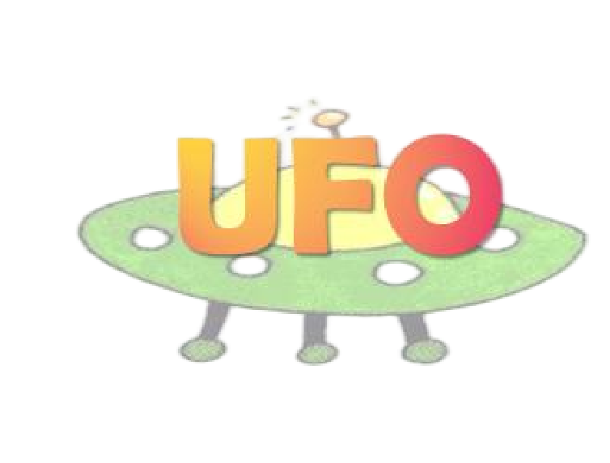
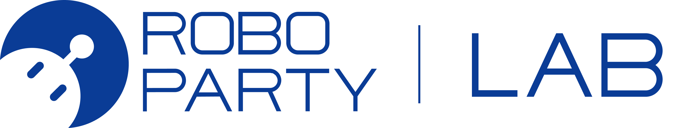

<h1 align="center">
  UFO: A General <b>U</b>nsupervised Reinforcement Learning <b>F</b>ramework for Humanoid C<b>O</b>ntrol
</h1>

<p align="center">
  <a href="https://roboparty.github.io/UFO/"></a>
  <a href="https://youtu.be/uJPcLdn9sNA"></a>
  <a href="https://roboparty.github.io/UFO/assets/UFO.pdf"></a>
</p>

<p align="center">
  <a href="README.md">English</a> | <a href="README_zh-CN.md">中文</a>
</p>

<p align="center">
  
  &nbsp;&nbsp;&nbsp;&nbsp;&nbsp;&nbsp;
  
</p>

UFO 是基于 **mjlab** 的人形机器人无监督强化学习框架，支持 **Unitree G1 / RoboParty RP1.3 / RPO**、多卡训练，以及 tracking、reward、goal 三种推理。G1 和 RP1 支持 **FB-CPR-Aux / TeCH**，RPO 发布基线使用 FB-CPR-Aux。

**RP1 的 TeCH 策略尚未进行真机测试。**

**[G1／RP1／RPO 训练数据](https://huggingface.co/datasets/xuewang/UFO-MotionData)和[已完成真机测试的 G1 FB policy](https://huggingface.co/xuewang/ufo-g1-policy)已发布。**

## News

**2026-10-15 — 训练性能与双机器人支持更新**

**FB / mjlab 完整 1.92 亿步训练**：下列实验均使用 **8 × NVIDIA H20**、**BF16 混合精度**、**1024 宽度网络与共享 critic**。

| 实验 | 全卡训练 FPS | 最后一次 EMD ↓ | 完成 1.92 亿步耗时 |
| --- | ---: | ---: | ---: |
| G1：原 DR＋原 reward | **12,440** | **0.6655** | **4 小时 45 分** |
| G1：扩展域随机化＋原 reward | **12,467** | **0.7406** | **约 4 小时 51 分** |
| G1：扩展域随机化＋新 reward | **12,217** | **0.7554** | **4 小时 55 分** |
| RP1：基准配置 | **12,485** | **0.7139** | **4 小时 48 分** |

<details>
<summary>测速配置与统计口径</summary>

各组均为每卡 1,024 个环境、batch size 1,024、六层残差主干，每次 rollout step 执行 16 次 agent 更新。FPS 表示八张卡合计的环境 transition 数／秒，取最后 20 条 FPS 日志的中位数，不代表包含全部开销的整场平均速度。

三组 G1 均使用 LaFAN-40 和 30% 躺倒初始化。原 DR 实验使用 reset 边界修复前的代码，“扩展域随机化＋原 reward”实验已包含该修复。这些历史实验跨越代码修改，不能视为仅改变 DR／reward 的严格对照。新 reward 将非期望接触惩罚替换为身体冲击惩罚，滑移惩罚权重改为 -4，并新增权重为 -2 的脚部绊倒惩罚。RP1 使用共同 LaFAN-40、关闭躺倒初始化。G1 的 BF16 为实验覆盖设置，当前 G1 FB 默认仍为 FP32＋TF32，RP1 FB 默认 BF16。

EMD 取最后一次周期跟踪评估的片段均值：三组 G1 均在 188,981,248 步评估 862 个片段，RP1 在 190,054,400 步评估 902 个片段，并非对最终 checkpoint 重新评估。总耗时包含启动、评估与 checkpoint 保存；除“G1：扩展域随机化＋原 reward”因缺少启动器结束时间、以启动至最终保存完成估算外，其余实验均使用启动器的起止记录。各组在名义 1.92 亿步预算下实际完成 191,995,904 步。

</details>

本次发布还将旧 `humanoidverse` 结构整理为 `ufo`，统一 G1／RP1、FB／TeCH 命令，修复 reset 边界观测与接触力方向，并提供机器人配置感知的 ONNX 导出、RP1 数据及已完成真机测试的 G1 policy。详见[代码结构](docs/ARCHITECTURE.md)和[训练与推理](docs/TRAIN_INFERENCE.md)。

## 安装

需要 Linux 和兼容 CUDA 12.8 的 NVIDIA 驱动。锁文件固定 PyTorch 2.7.1 / CUDA 12.8 和 NCCL 2.26.5，支持 Blackwell 显卡。执行以下命令，后续操作均在仓库根目录进行：

```bash
git clone https://github.com/Roboparty/UFO.git
cd UFO
python3 -m pip install --user uv
export PATH="$HOME/.local/bin:$PATH"
uv sync --locked
```

本文适用于包含 `ufo/` 和 `run_inference.sh` 的 mjlab 版本，不适用于旧的 `humanoidverse/` 版本。保存视频需要 `ffmpeg`，Ubuntu 可用 `sudo apt install ffmpeg` 安装。

## 准备数据

下载对应机器人的完整动作和训练片段，脚本会校验 SHA256：

```bash
bash scripts/download_data.sh g1_lafan
bash scripts/download_data.sh rp1_lafan
bash scripts/download_data.sh rpo_lafan
```

G1 包含 40 条动作；RP1 包含 55 条动作和 1,166 个训练片段；RPO 包含 56 条动作和 1,168 个训练片段。RP1 和 RPO 数据均为 50 Hz，使用各自的关节布局。不同机器人的数据不能直接混用。

已有文件（包括 RPO 数据）时，见[本地数据放置说明](docs/ROBOT_ADAPTATION.md#use-converted-data)。自行转换源数据时，见 [RP1](docs/ROBOT_ADAPTATION.md#rp1-data-import) 和 [RPO](docs/ROBOT_ADAPTATION.md#rpo-data-import) 数据导入说明。

## 训练

准备好数据后，选择一条命令运行：

```bash
./run_train.sh --robot g1  --agent fb   --gpu-ids all
./run_train.sh --robot rp1 --agent fb   --gpu-ids all
./run_train.sh --robot rpo --agent fb   --gpu-ids all
./run_train.sh --robot g1  --agent tech --gpu-ids all
./run_train.sh --robot rp1 --agent tech --gpu-ids all
```

RPO TeCH 尚未验证，不属于当前发布的 RPO 基线。

`--gpu-ids all` 使用所有可见 GPU，通过 `CUDA_VISIBLE_DEVICES` 选择显卡。`--gpu-ids single --smoke` 只检查启动和采样，不更新权重；需要验证参数更新时，使用[短训练检查](docs/TRAIN_INFERENCE.md#short-training-check)。

默认输出到 `runs/<robot>_<agent>`。每个新实验请使用独立的 `--work-dir`；目录中已有 checkpoint 时会恢复训练。启用 W&B：

```bash
uv run wandb login
WANDB_PROJECT=UFO ./run_train.sh --robot g1 --agent fb --gpu-ids all \
  --work-dir runs/g1_fb_exp --use-wandb --wandb-run-name g1_fb_exp
```

## 推理

推理自动读取训练时保存的机器人配置。使用对应机器人的 checkpoint 和匹配的动作数据：

```bash
./run_inference.sh tracking --model-folder runs/g1_fb --motion-list 0 --save-mp4
./run_inference.sh reward --model-folder runs/g1_fb --save-mp4
./run_inference.sh goal --model-folder runs/g1_fb \
  --data-path ufo/data/lafan_29dof.pkl --save-mp4
```

- **Tracking**：G1／RP1 支持 FB 和 TeCH，RPO 支持 FB；可用 `--data-path` 指定动作数据。
- **Reward**：仅支持 FB，需要保存的 rank-0 replay；RP1 和 RPO 当前支持根节点运动与移动类任务。
- **Goal**：G1／RP1 支持 FB 和 TeCH，RPO 支持 FB；需要使用与机器人匹配的完整动作数据和目标 JSON。命令见 [Goal 推理](docs/TRAIN_INFERENCE.md#goal-inference)。

完整参数见 `./run_inference.sh <tracking|reward|goal> --help`。

[已发布的 G1 FB 模型](https://huggingface.co/xuewang/ufo-g1-policy)包含约 1.92 亿步的 checkpoint、ONNX，以及配套的 tracking、goal、向前行走 reward z。下载到 `model/` 后可直接运行：

```bash
uv run hf download xuewang/ufo-g1-policy --local-dir model
./run_inference.sh tracking --model-folder model/g1_policy \
  --data-path ufo/data/lafan_29dof.pkl --motion-list 7 --save-mp4
```

发布包包含模型权重，不含优化器状态和 replay buffer。重新计算其他 reward z 需要自行保存的 replay；包内 reward z 可直接用于部署。

## 更多文档

- [训练与推理](docs/TRAIN_INFERENCE.md)：默认配置、评估、checkpoint 和推理参数。
- [机器人与数据适配](docs/ROBOT_ADAPTATION.md)：通过 `robot_setup` 添加机器人、导入已重定向的动作数据。
- [代码结构](docs/ARCHITECTURE.md)：目录与模块职责。
- [G1 真机部署](https://github.com/Roboparty/UFO/tree/deploy)。
- **RP1 的 UFO 部署请见 [Roboparty/roboparty_deploy](https://github.com/Roboparty/roboparty_deploy)。**

## 引用与许可

<details>
<summary>引用 UFO</summary>

```bibtex
@misc{ufo2026,
  author       = {{RoboParty Lab Team}},
  title        = {UFO: An Unsupervised Reinforcement Learning Framework for Humanoid Control},
  year         = {2026},
  howpublished = {\url{https://github.com/Roboparty/UFO}},
  note         = {Project page: \url{https://roboparty.github.io/UFO/}}
}
```

</details>

UFO 采用 [CC BY-NC 4.0](LICENSE) 许可，用于非商业研究。
RPO 模型和网格保留其 [CERN-OHL-W-2.0 许可](ufo/data/robots/rpo/LICENSE)。
